# LightSense OLED 页面草图清单（128×64）

依据当前源码 `src/oled.cpp` 复刻；4× 最近邻放大（512×256），白底黑像素，黑=点亮。
字体直接解码固件同款 U8g2 点阵字库（wqy12 / wqy16），非 TTF 近似。

## 页面清单

| 编号 | 页面 | 状态 | 函数 | 源码 | 图 |
| --- | --- | --- | --- | --- | --- |
| 01 | 频闪仪（页 0） | 合规 PASS（默认态） | `drawMeterPage()` | `src/oled.cpp:103-134` | 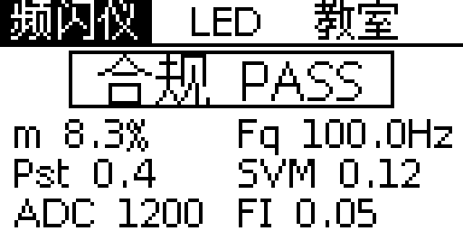 |
| 02 | 频闪仪（页 0） | 双超标（判定文案与框宽变化） | `drawMeterPage()` | `src/oled.cpp:103-134` | 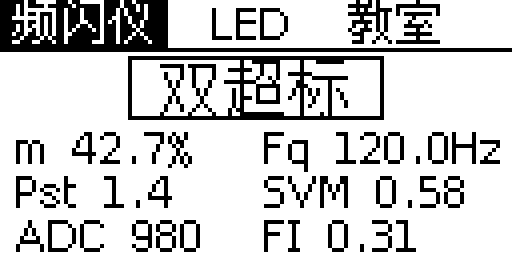 |
| 03 | LED（页 1） | 当前输出=常灭，光标=常灭 | `drawLedPage()` | `src/oled.cpp:138-164` | 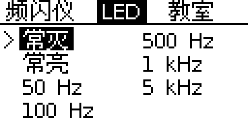 |
| 04 | LED（页 1） | 光标=5 kHz，当前输出=1 kHz | `drawLedPage()` | `src/oled.cpp:138-164` | 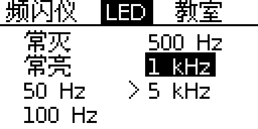 |
| 05 | 教室（页 2） | 第 1 步 · 巡检选中，有上次记录 | `drawClassroomPage()` | `src/oled.cpp:224-259` | 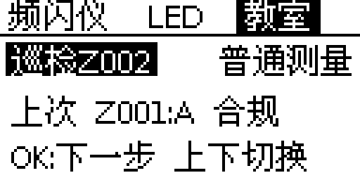 |
| 06 | 教室（页 2） | 第 1 步 · 普通测量选中，无记录 | `drawClassroomPage()` | `src/oled.cpp:224-259` | 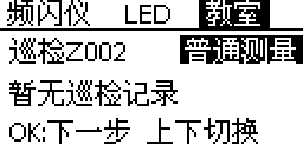 |
| 07 | 教室（页 2） | 第 2 步 · 30s 选中 | `drawClassroomPage()` | `src/oled.cpp:297-316` | 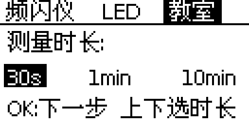 |
| 08 | 教室（页 2） | 第 2 步 · 1min 选中 | `drawClassroomPage()` | `src/oled.cpp:297-316` | 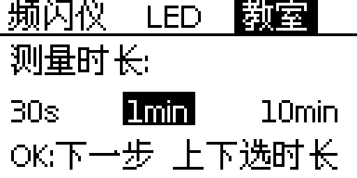 |
| 09 | 教室（页 2） | 第 2 步 · 10min 选中 | `drawClassroomPage()` | `src/oled.cpp:297-316` | 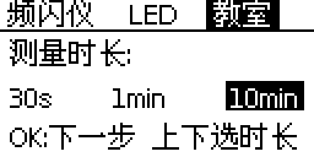 |
| 10 | 教室（页 2） | 第 3 步 · 巡检确认（Z002，30s） | `drawClassroomPage()` | `src/oled.cpp:261-295` | 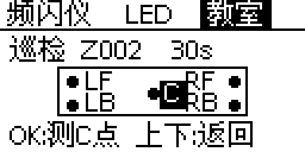 |
| 11 | 教室（页 2） | 第 3 步 · 普通测量确认（30s） | `drawClassroomPage()` | `src/oled.cpp:261-295` | 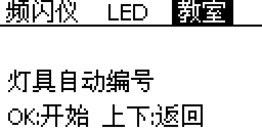 |
| 12 | 教室（页 2） | 巡检进行中 · 空闲（Z001 2/5，下一点 RF 右前） | `drawClassroomPage() → inspection idle 分支` | `src/oled.cpp:196-214` | 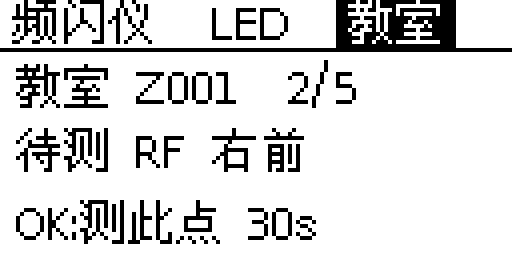 |
| 13 | 教室（页 2） | 巡检 5 点已测完（Z001 5/5） | `drawClassroomPage() → inspection idle 分支` | `src/oled.cpp:196-214` | 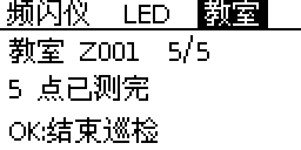 |
| 14 | 教室（页 2） | 测量进行中（巡检 Z001-C，12/29，剩余 17s） | `drawClassroomPage() → running 分支` | `src/oled.cpp:172-193` | 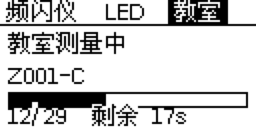 |
| 15 | 教室（页 2） | 测量进行中（巡检 Z001-C，125/586，剩余 7:52） | `drawClassroomPage() → running 分支` | `src/oled.cpp:172-193` | 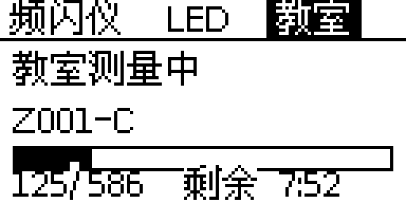 |
| 16 | 教室（页 2） | 普通测量进行中（灯具 1，9/29） | `drawClassroomPage() → running 分支` | `src/oled.cpp:172-193` | 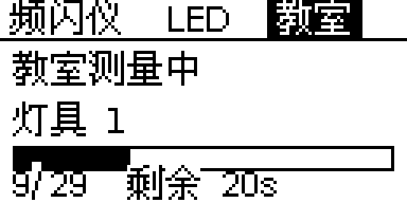 |
| 17 | 全局临时提示条（覆盖任一页） | 记录已满提示（叠在第 2 步背景上） | `oledMsg() + drawAll()` | `src/oled.cpp:36-41, 331-336` | 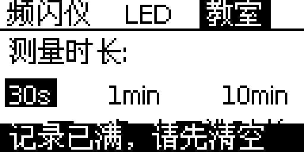 |

## 合并图（3×2 六页对照，供专利交底书使用）

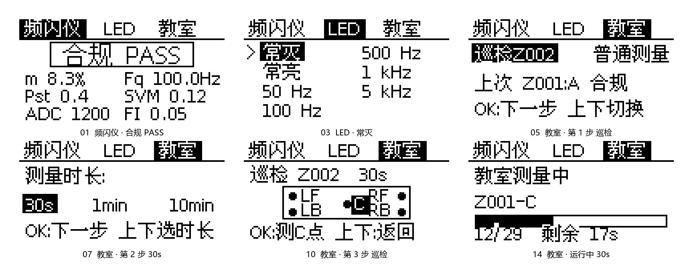

- 文件：`oled-merge-01-03-05-07-10-14.png`，1728×694 px，单色 L，白底，无边框/阴影/渐变
- 排布：3 列 × 2 行；第一行 01、03、05，第二行 07、10、14（阅读序左→右、上→下）
- 拼接：每张保持 512×256，按 1:1 整数像素直接粘贴，未缩放、未重采样
- 标注：统一置于图下方，字号 20，距图底 12 px，水平居中，纯黑

| 编号 | 页面 / 状态 | 源文件 | 落位左上角 (x, y) | 占位 |
| --- | --- | --- | --- | --- |
| 01 | 频闪仪 · 合规 PASS | `01_meter_pass.png` | (48, 48) | 512×256 |
| 03 | LED · 常灭 | `03_led_default.png` | (608, 48) | 512×256 |
| 05 | 教室 · 第 1 步 巡检 | `05_classroom_step1_inspect.png` | (1168, 48) | 512×256 |
| 07 | 教室 · 第 2 步 30s | `07_classroom_step2_30s.png` | (48, 352) | 512×256 |
| 10 | 教室 · 第 3 步 巡检 | `10_classroom_step3_inspect.png` | (608, 352) | 512×256 |
| 14 | 教室 · 运行中 30s | `14_classroom_running_30s.png` | (1168, 352) | 512×256 |

排版参数：列 x = 48 / 608 / 1168，行 y = 48 / 352；图与图横向、纵向间距均为 48，四周留白 48。
校验：生成后按上述坐标从合并图裁回六张，与原始 PNG 逐像素比对全部一致；原始六张 PNG 均未改动。

## 逐页说明

### 01 频闪仪（页 0） · 合规 PASS（默认态）

- 触发：上电默认 s_page=0；左右键循环切页。本页上下/OK 无动作（OK 仅触发一次重绘）
- 函数：`drawMeterPage()`（src/oled.cpp:103-134）
- 关键元素：三页签；16px 判定文本（ZONE_OLED[zone]）+ 按文本宽自适应的判定框；6 项指标两列
- 本图取值：zone=0 → “合规 PASS”；示例快照 m 8.3% / Fq 100.0Hz / Pst 0.4 / SVM 0.12 / ADC 1200 / FI 0.05
- 备注：判定框宽 = 文本宽 + 16，上限 124；bx=(128-bw)/2，避免画满 128 列造成面板包绕（oled.cpp:110-116）

### 02 频闪仪（页 0） · 双超标（判定文案与框宽变化）

- 触发：同页 0，由 snap->zone=3 切换判定文案；无独立结果页
- 函数：`drawMeterPage()`（src/oled.cpp:103-134）
- 关键元素：16px “双超标” + 框宽 64（文本 48+16）；指标值随快照变化
- 本图取值：zone=3 → “双超标”；m 42.7% / Fq 120.0Hz / Pst 1.4 / SVM 0.58 / ADC 980 / FI 0.31
- 备注：同一页面只换数据与判定文案，布局不变；Pst 按 %.1f 输出，1.35 显示为 1.4

### 03 LED（页 1） · 当前输出=常灭，光标=常灭

- 触发：页 0 右键 / 页 2 左键进入；进入后 s_ledSel 保留上次光标
- 函数：`drawLedPage()`（src/oled.cpp:138-164）
- 关键元素：7 模式两列网格（列优先：左列 0–3，右列 4–6）；反白=当前实际输出；> = 预选光标；上下键在 7 模式循环；OK 应用
- 本图取值：ledPwmGetMode()=0 → “常灭”反白；s_ledSel=0 → “>”在常灭左侧（x=2）
- 备注：模式名来自 led_pwm.cpp MODES 表（L14-L21），与网页 /led 参数同源

### 04 LED（页 1） · 光标=5 kHz，当前输出=1 kHz

- 触发：上下键移动 s_ledSel，OK 前不改变输出；本例 s_ledSel=6、当前模式=5
- 函数：`drawLedPage()`（src/oled.cpp:138-164）
- 关键元素：反白块只跟随当前输出（1 kHz），> 光标独立停在 5 kHz
- 本图取值：cur=5 → “1 kHz”反白；s_ledSel=6 → “>”在 5 kHz 左侧（x=64）
- 备注：确认后光标与反白重合；两列 x=12/74，行距 12，首行基线 y=25

### 05 教室（页 2） · 第 1 步 · 巡检选中，有上次记录

- 触发：左/右键进入页 2 时 s_clsStage=0；上下键切换 s_clsMode；OK → 第 2 步
- 函数：`drawClassroomPage()`（src/oled.cpp:224-259）
- 关键元素：模式项“巡检Z002”（巡检 + 下一个自动编号预览）与“普通测量”；“上次 Z001:A 合规”；底行操作提示
- 本图取值：nextAutoNo=2 → Z002；已完成记录 Z001、verdict=1 → “A 合规”
- 备注：“上次…”行经 fitUTF8(buf,124) 截尾；本例 96px 不触发

### 06 教室（页 2） · 第 1 步 · 普通测量选中，无记录

- 触发：第 1 步上下键切到 s_clsMode=1；无已完成巡检任务
- 函数：`drawClassroomPage()`（src/oled.cpp:224-259）
- 关键元素：“普通测量”反白框 x76–127 贴右缘；“暂无巡检记录”
- 本图取值：无 status=DONE 的任务 → last=NULL；普通测量文本 48px，框宽 52
- 备注：右缘贴边是代码坐标结果（xm[1]=78），未做避让

### 07 教室（页 2） · 第 2 步 · 30s 选中

- 触发：第 1 步按 OK → s_clsStage=1；上下键循环三档；OK → 第 3 步
- 函数：`drawClassroomPage()`（src/oled.cpp:297-316）
- 关键元素：“测量时长:” + 三档选项（30s/1min/10min），反白当前档；底行提示
- 本图取值：s_durSel=0 → 30s 反白（x2–23）
- 备注：三档 x=4/46/94，框高 12、基线 44；底行提示会被临时消息条覆盖

### 08 教室（页 2） · 第 2 步 · 1min 选中

- 触发：上下键循环 s_durSel=1
- 函数：`drawClassroomPage()`（src/oled.cpp:297-316）
- 关键元素：1min 反白框 x44–71；另两档正常显示
- 本图取值：DUR_NAMES[1]="1min"；窗口数 CLS_WINDOWS_1MIN
- 备注：三档窗口数见 DUR_WINDOWS（oled.cpp:44），与网页三档一致

### 09 教室（页 2） · 第 2 步 · 10min 选中

- 触发：上下键循环 s_durSel=2
- 函数：`drawClassroomPage()`（src/oled.cpp:297-316）
- 关键元素：10min 反白框 x92–125；右侧留 2px
- 本图取值：DUR_NAMES[2]="10min"；窗口数 CLS_WINDOWS_10MIN
- 备注：框 + 文本总宽 34px，未越过 127 列

### 10 教室（页 2） · 第 3 步 · 巡检确认（Z002，30s）

- 触发：第 2 步按 OK → s_clsStage=2；上下键返回第 2 步；OK 建立自动编号任务并从 C 点开测
- 函数：`drawClassroomPage()`（src/oled.cpp:261-295）
- 关键元素：标题“巡检 Z002  30s”；教室轮廓 80×21（x24–103,y28–48）；5 个测点圆点；LF/RF/LB/RB；中心 C 反白块 x67–78；底行“OK:测C点 上下:返回”
- 本图取值：s_clsMode=0、nextAutoNo=2、s_durSel=0
- 备注：C 反白块后画，覆盖 RF 首列；C 文本基线 43，圆点半径 2（drawDisc）

### 11 教室（页 2） · 第 3 步 · 普通测量确认（30s）

- 触发：s_clsMode=1 时第 3 步；OK → classroomStart(NULL,…)，灯具自动编号
- 函数：`drawClassroomPage()`（src/oled.cpp:261-295）
- 关键元素：标题“普通测量  30s”；中部“灯具自动编号”；底行“OK:开始 上下:返回”
- 本图取值：s_clsMode=1、s_durSel=0
- 备注：不显示教室点位图（仅巡检模式绘制）

### 12 教室（页 2） · 巡检进行中 · 空闲（Z001 2/5，下一点 RF 右前）

- 触发：巡检任务已建立且 classroomIsRunning()=false；上下键仍可改时长；OK 测下一点，5 点齐全则结束
- 函数：`drawClassroomPage() → inspection idle 分支`（src/oled.cpp:196-214）
- 关键元素：“教室 Z001  2/5”；“待测 RF 右前”；“OK:测此点 30s”
- 本图取值：pointsCount=2 → 下一点 RF（顺序 C→LF→RF→LB→RB）；s_durSel=0
- 备注：教室号过长时 fitUTF8 截尾，避免右缘包绕

### 13 教室（页 2） · 巡检 5 点已测完（Z001 5/5）

- 触发：classroomInspectNextPoint()=0 且任务仍 active；OK → classroomInspectFinish()
- 函数：`drawClassroomPage() → inspection idle 分支`（src/oled.cpp:196-214）
- 关键元素：“教室 Z001  5/5”；“5 点已测完”；“OK:结束巡检”
- 本图取值：pointsCount=5、next=0
- 备注：结束后无独立结果页，回到第 1 步菜单；汇总结果在网页端查看

### 14 教室（页 2） · 测量进行中（巡检 Z001-C，12/29，剩余 17s）

- 触发：OK 启动后 classroomIsRunning()=true；运行中 OK 忽略，左右仍可切页看实时值
- 函数：`drawClassroomPage() → running 分支`（src/oled.cpp:172-193）
- 关键元素：“教室测量中”；标签“Z001-C”；进度框 120×8（y46–53）；填充=done*120/target；“12/29  剩余 17s”
- 本图取值：done=12、target=29（30s 档）；fill=49px；remS=(29-12)*1024/1000=17
- 备注：底行基线 62，CJK 字顶行落在 y52–53，与进度框底边重叠；按代码如实复现

### 15 教室（页 2） · 测量进行中（巡检 Z001-C，125/586，剩余 7:52）

- 触发：10min 档启动后的运行态
- 函数：`drawClassroomPage() → running 分支`（src/oled.cpp:172-193）
- 关键元素：同一运行页；剩余 ≥60s 时格式化为 m:ss
- 本图取值：done=125、target=586；fill=25px；remS=(586-125)*1024/1000=472 → 7:52
- 备注：底部文字 104px，未越过右缘

### 16 教室（页 2） · 普通测量进行中（灯具 1，9/29）

- 触发：第 3 步普通测量 OK → classroomStart(NULL,…)，标签自动命名“灯具 N”
- 函数：`drawClassroomPage() → running 分支`（src/oled.cpp:172-193）
- 关键元素：“教室测量中”；标签“灯具 1”；进度 9/29；剩余 20s
- 本图取值：classroomStart(NULL) → “灯具 1”；done=9、target=29
- 备注：普通测量没有独立页面，复用教室页运行态（oled.cpp:410）

### 17 全局临时提示条（覆盖任一页） · 记录已满提示（叠在第 2 步背景上）

- 触发：创建巡检失败 → “任务/记录已满”（L408）；普通测量失败 → “记录已满, 请先清空”（L416）；显示 3 秒（L40）
- 函数：`oledMsg() + drawAll()`（src/oled.cpp:36-41, 331-336）
- 关键元素：反白条 0,52,128,12；文字基线 62，x=4；覆盖当前页底行
- 本图取值：s_msg="记录已满, 请先清空"，宽 108px
- 备注：全页唯一底部反白提示条；不是低电量条（固件当前无电池模块）

## 代码中不存在的页面（未绘制）

- **开机 / 引导页**：不存在；`oledBegin()` 仅初始化（oled.cpp:67-75），首帧在首个报告窗口或按键后。
- **巡检结果页**：不存在独立页；只有第 1 步“上次…”预览与 5/5 结束态，完整结果在网页端。
- **普通测量结果页**：不存在；实时指标在页 0，结果汇总在网页端。
- **记录列表页**：不存在。
- **设置 / WiFi 页**：不存在；WiFi 只用网页 /setup 配置。
- **低电量提示条 / 电池图标**：当前源码无电池模块；唯一底部反白条是 `oledMsg()`（L36-41、L331-336）。

## 复现说明

- 运行页进度框 y46–53 与底行基线 y62 的 CJK 字顶行（y52–53）重叠；solid 字模会擦出缺口，图 14–16 如实保留。
- 第 3 步 C 反白块 x67–78 覆盖 RF 文本首列 x78；图 10 如实保留。
- 动态数值为代表性样例；坐标、格式字符串、字宽均来自源码。
- 未改动任何固件代码。
